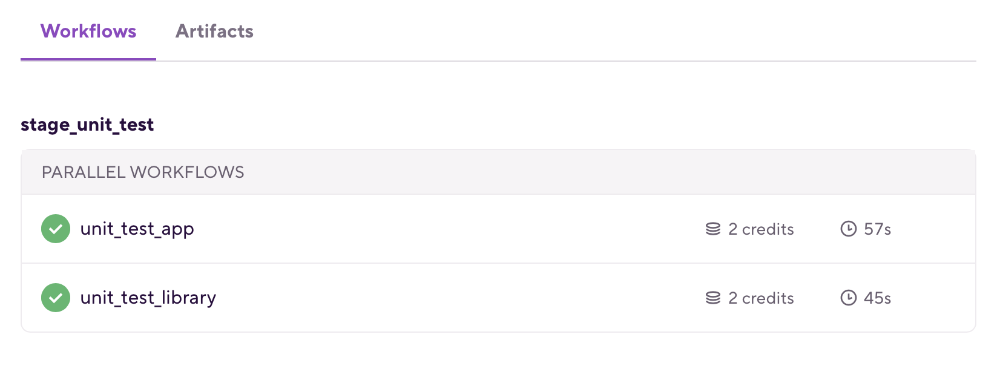

# (Android) Unit test sharding by module

## Description

Running the unit tests of a modularized app in parallel Workflows utilizing Pipelines.

This Pipeline contains two Workflows which are executed in parallel:

1. `unit_test_app`: This Workflow runs the unit tests of the `app` module.
1. `unit_test_library`: This Workflow runs the unit tests of the `lib-example` module.

Both Workflows use the `unit_test` [Step bundle](https://docs.bitrise.io/en/bitrise-ci/workflows-and-pipelines/steps/step-bundles) with a different `module` input. The bundle clones the repository, runs the unit tests with the `android-unit-test` Step, and ends with the `deploy-to-bitrise-io` Step, which makes the test results available on the **Tests** tab of the build page.



## Instructions

To test this configuration in a new Bitrise example project, do the following:

1. Visit the [Create New App page](https://app.bitrise.io/apps/add) to create a new App.
1. When prompted to select a git repository, choose **Other/Manual** and paste the sample project repository URL (`https://github.com/bitrise-io/Bitrise-Android-Modules-Sample.git`) in the **Git repository (clone) URL** field.
1. Confirm that this is a public repository in the resulting pop-up.
1. Select the `main` branch to scan.
1. Wait for the project scanner to complete.
1. Enter `app` as the specified module.
1. Enter `debug` as the specified variant.
1. Continue through the prompts as normal — no changes are needed.
1. Open the new Bitrise project’s Workflow Editor.
1. Go to the **bitrise.yml** tab, and replace the existing yaml contents with the contents of the example `bitrise.yml` below.
1. Click the **Start/Schedule a Build** button, and select the `pipeline_unit_test` option in the **Workflow, Pipeline** dropdown menu at the bottom of the popup.

## bitrise.yml

```yaml
format_version: "26"
default_step_lib_source: https://github.com/bitrise-io/bitrise-steplib.git
project_type: android

meta:
  bitrise.io:
    stack: ubuntu-latest-stable
    machine_type_id: standard

pipelines:
  pipeline_unit_test:
    workflows:
      unit_test_app: {}
      unit_test_library: {}

step_bundles:
  unit_test:
    inputs:
    - module: ""
    - variant: ""
    steps:
    - git-clone@8: {}
    - android-unit-test@1:
        inputs:
        - module: $module
        - variant: $variant
    - deploy-to-bitrise-io@2: {}

workflows:
  unit_test_app:
    steps:
    - bundle::unit_test:
        inputs:
        - module: app
        - variant: debug

  unit_test_library:
    steps:
    - bundle::unit_test:
        inputs:
        - module: lib-example
```
