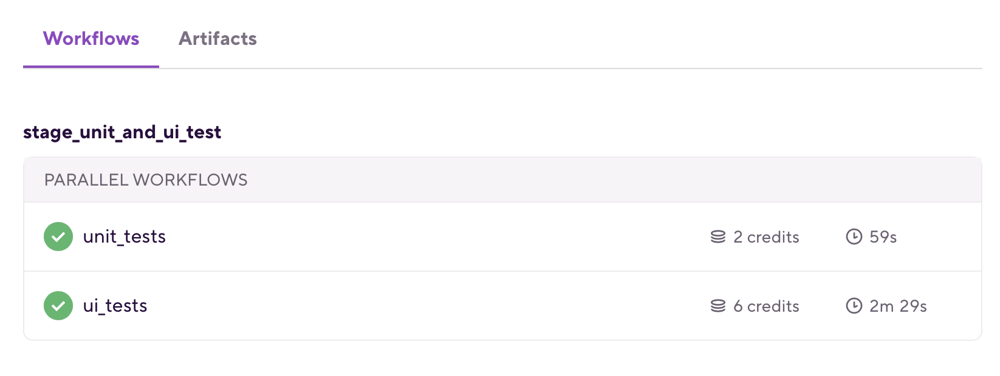

# (Android) Run unit and UI tests in parallel

## Description

Running unit tests and UI tests in parallel utilizing Pipelines.

This Pipeline contains two Workflows which are executed in parallel:

1. `unit_tests`: This Workflow simply runs the unit tests of the given module and variant using the `android-unit-test` Step.
1. `ui_tests`: This Workflow spins up an emulator and waits for it to boot using the `avd-manager` Step, runs the UI tests of the given module and variant with Gradle using the `gradle-runner` Step, and collects the JUnit XML results using the `custom-test-results-export` Step.

Both Workflows end with the `deploy-to-bitrise-io` Step, which makes their test results available on the **Tests** tab of the build page.



## Instructions

To test this configuration in a new Bitrise example project, do the following:

1. Visit the [Create New App page](https://app.bitrise.io/apps/add) to create a new App.
1. When prompted to select a git repository, choose **Other/Manual** and paste the sample project repository URL (`https://github.com/bitrise-io/Bitrise-Android-Modules-Sample.git`) in the **Git repository (clone) URL** field.
1. Confirm that this is a public repository in the resulting pop-up.
1. Select the `main` branch to scan.
1. Wait for the project scanner to complete.
1. Enter `app` as the specified module.
1. Enter `debug` as the specified variant.
1. Continue through the prompts as normal — no changes are needed.
1. Open the new Bitrise project’s Workflow Editor.
1. Go to the **bitrise.yml** tab, and replace the existing yaml contents with the contents of the example `bitrise.yml` below.
1. Click the **Start/Schedule a Build** button, and select the `pipeline_unit_and_ui_test` option in the **Workflow, Pipeline** dropdown menu at the bottom of the popup.

## bitrise.yml

```yaml
format_version: "26"
default_step_lib_source: https://github.com/bitrise-io/bitrise-steplib.git
project_type: android

meta:
  bitrise.io:
    stack: ubuntu-latest-stable
    machine_type_id: standard

pipelines:
  pipeline_unit_and_ui_test:
    workflows:
      unit_tests: {}
      ui_tests: {}

workflows:
  unit_tests:
    steps:
    - git-clone@8: {}
    - android-unit-test@1:
        inputs:
        - module: app
        - variant: debug
    - deploy-to-bitrise-io@2: {}

  ui_tests:
    steps:
    - git-clone@8: {}
    - avd-manager@2:
        inputs:
        - api_level: 34
        - tag: google_apis
        - abi: x86_64
    - gradle-runner@6:
        inputs:
        - gradlew_path: ./gradlew
        - gradle_task: connectedDebugAndroidTest
    - custom-test-results-export@2:
        inputs:
        - search_pattern: "*.xml"
        - base_path: $BITRISE_SOURCE_DIR/app/build/outputs/androidTest-results
        - test_name: UI tests
    - deploy-to-bitrise-io@2: {}
```
