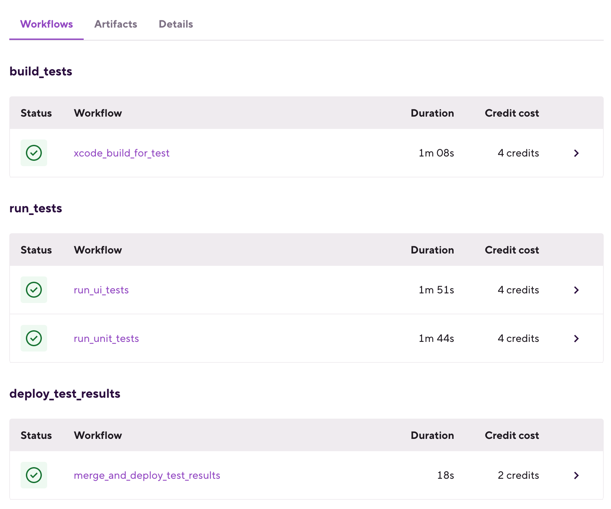

# (iOS) Merging test results from parallel Workflows into one build

## Description

Each Workflow of a Pipeline runs in its own build and deploys its test results to the **Tests** tab of that build. To collect all the test results generated in different builds in a single build, the results need to be merged and deployed in an additional build.

This example uses the [sample-swift-project-with-parallel-ui-test](https://github.com/bitrise-io/sample-swift-project-with-parallel-ui-test) iOS Open Source sample app and extends the [Run iOS test groups in parallel](./ios-run-test-groups-in-parallel.md) example Pipeline config with merging and deploying test results.

`run_ui_tests` and `run_unit_tests` Workflows run their Test Plan with the `run_tests` Step bundle, and share their `.xcresult` bundles with the following workflows in the graph through the `deploy-to-bitrise-io` Step.

`build_and_run_tests` Pipeline is extended with a new workflow: `merge_and_deploy_test_results`.

This Workflow does the following:
1. `pull-intermediate-files` Step downloads the test results generated in the previous workflows (`run_ui_tests` and `run_unit_tests`).
1. `script` Step moves each test result into a new test run directory within `$BITRISE_TEST_RESULT_DIR` and creates the related `test-info.json` file.
1. `deploy-to-bitrise-io` Step deploys the merged test results.



## Instructions

1. Visit the [Create New App page](https://app.bitrise.io/apps/add) to create a new App.
1. When prompted to select a git repository, choose **Other/Manual** and paste the sample project repository URL (`https://github.com/bitrise-io/sample-swift-project-with-parallel-ui-test`) in the **Git repository (clone) URL** field.
1. Confirm that this is a public repository in the resulting pop-up.
1. Select the `master` branch to scan.
1. Wait for the project scanner to complete.
1. Select any of the offered Distribution methods (for example development, it does not really matter as now we are focusing on testing).
1. Confirm the offered stack, skip choosing the app icon and the webhook registration and kick off the first build.
1. Open the new Bitrise project’s Workflow Editor.
1. Go to the **bitrise.yml** tab and replace the existing `bitrise.yml` with the contents of the example bitrise.yml below.
1. Click the **Start/Schedule a Build** button, and select the `build_and_run_tests` Pipeline option in the **Workflow, Pipeline** dropdown menu at the bottom of the popup.
1. Open the Pipeline's build page.
1. Select the `merge_and_deploy_test_results` build.
1. Open the **Tests** tab to view the merged test results.

## bitrise.yml

```yaml
---
format_version: '26'
default_step_lib_source: https://github.com/bitrise-io/bitrise-steplib.git
project_type: ios

app:
  envs:
  - BITRISE_PROJECT_PATH: BullsEye.xcworkspace
  - BITRISE_SCHEME: BullsEye

meta:
  bitrise.io:
    stack: osx-xcode-latest-stable
    machine_type_id: g2.mac.medium

pipelines:
  build_and_run_tests:
    workflows:
      xcode_build_for_test: {}
      run_ui_tests:
        depends_on: [xcode_build_for_test]
      run_unit_tests:
        depends_on: [xcode_build_for_test]
      merge_and_deploy_test_results:
        depends_on: [run_ui_tests, run_unit_tests]

step_bundles:
  run_tests:
    inputs:
    - test_plan: ""
    steps:
    - pull-intermediate-files@1:
        inputs:
        - artifact_sources: xcode_build_for_test
    - script@1:
        title: Find the xctestrun file
        inputs:
        - content: |-
            set -eo pipefail
            xctestrun=$(ls "$BITRISE_TEST_BUNDLE_PATH"/BullsEye_"$test_plan"_*.xctestrun)
            envman add --key XCTESTRUN_PATH --value "$xctestrun"
    - xcode-test-without-building@1:
        inputs:
        - xctestrun: $XCTESTRUN_PATH
        - destination: platform=iOS Simulator,name=Bitrise iOS default,OS=latest

workflows:
  xcode_build_for_test:
    steps:
    - git-clone@8: {}
    - xcode-build-for-test@3:
        inputs:
        - destination: generic/platform=iOS Simulator
    - deploy-to-bitrise-io@2:
        inputs:
        - pipeline_intermediate_files: "$BITRISE_TEST_BUNDLE_PATH:BITRISE_TEST_BUNDLE_PATH"

  run_ui_tests:
    steps:
    - bundle::run_tests:
        inputs:
        - test_plan: UITests
    - deploy-to-bitrise-io@2:
        inputs:
        - pipeline_intermediate_files: "$BITRISE_XCRESULT_PATH:BITRISE_UI_TEST_XCRESULT_PATH"

  run_unit_tests:
    steps:
    - bundle::run_tests:
        inputs:
        - test_plan: UnitTests
    - deploy-to-bitrise-io@2:
        inputs:
        - pipeline_intermediate_files: "$BITRISE_XCRESULT_PATH:BITRISE_UNIT_TEST_XCRESULT_PATH"

  merge_and_deploy_test_results:
    steps:
    - pull-intermediate-files@1:
        inputs:
        - artifact_sources: .*
    - script@1:
        inputs:
        - content: |
            #!/usr/bin/env bash
            set -eo pipefail

            for item in "${BITRISE_UI_TEST_XCRESULT_PATH}" "${BITRISE_UNIT_TEST_XCRESULT_PATH}";
              do
                echo "Exporting ${item}"

                test_name=$(basename "$item" .xcresult)
                echo "Test name: $test_name"

                test_dir="${BITRISE_TEST_RESULT_DIR}/${test_name}"
                mkdir -p "${test_dir}"
                echo "Moving test result to: ${test_dir}"
                cp -R "${item}" "${test_dir}/$(basename ${item})"

                test_info="${test_dir}/test-info.json"
                echo "Creating Test info at: ${test_info}"
                echo "{ \"test-name\": \"${test_name}\" }" > "$test_info"
              done
    - deploy-to-bitrise-io@2: {}
```
