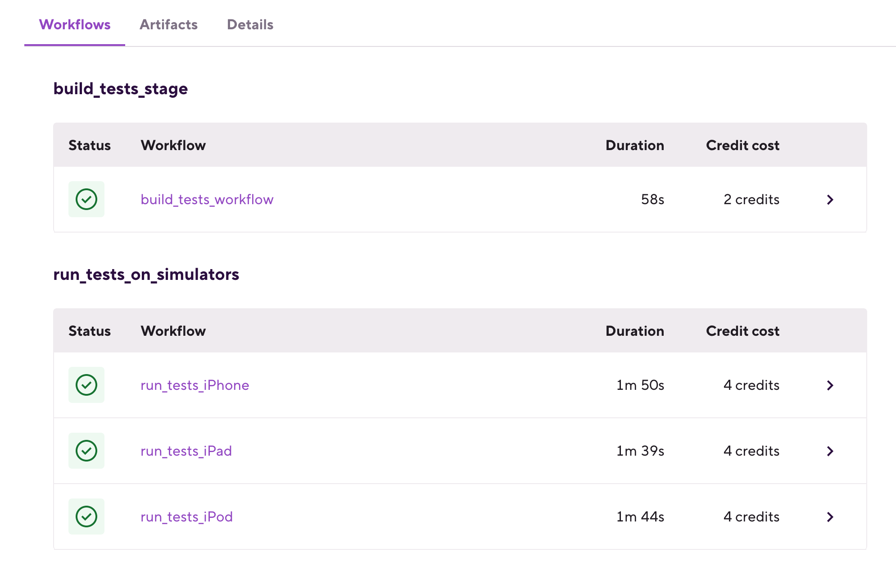

# (iOS) Run tests in parallel on multiple simulators

## Description

This example uses the [sample-swift-project-with-parallel-ui-test](https://github.com/bitrise-io/sample-swift-project-with-parallel-ui-test) iOS Open Source sample app, which has some example Unit and UI tests and uses Test Plans to group the tests.

The example Pipeline config showcases how to run all the test cases of the project on different iOS simulators.

`build_and_run_tests` pipeline's Workflows can be split into two logical groups:
1. Build tests: The `xcode_build_for_test` Workflow git clones the sample project and runs the `xcode-build-for-test` Step to build the target and associated tests. The built test bundle is shared with the other workflows via the `deploy-to-bitrise-io` Step.

    **Note**: `xcode-build-for-test` Step compresses the built test bundle and moves the generated zip to the `$BITRISE_DEPLOY_DIR`, that directory’s content is deployed to the Workflow artifacts by default via the `deploy-to-bitrise-io` Step.

1. Run tests: Two Workflows are executed in parallel: `run_tests_on_iPhone` and `run_tests_on_iPad`. Both use the `run_tests` [Step bundle](https://docs.bitrise.io/en/bitrise-ci/workflows-and-pipelines/steps/step-bundles) with a different `destination` input. The bundle pulls the pre-built test bundle, finds the `.xctestrun` file of the `FullTests` Test Plan (its name contains the SDK version, which changes with the Xcode version of the stack), and runs the tests with the `xcode-test-without-building` Step. The `deploy-to-bitrise-io` Step at the end of each Workflow makes its test results available on the **Tests** tab of the build page.



## Instructions

1. Visit the [Create New App page](https://app.bitrise.io/apps/add) to create a new App.
1. When prompted to select a git repository, choose **Other/Manual** and paste the sample project repository URL (`https://github.com/bitrise-io/sample-swift-project-with-parallel-ui-test`) in the **Git repository (clone) URL** field.
1. Confirm that this is a public repository in the resulting pop-up.
1. Select the `master` branch to scan.
1. Wait for the project scanner to complete.
1. Select any of the offered Distribution methods (for example development, it does not really matter as now we are focusing on testing).
1. Confirm the offered stack, skip choosing the app icon and the webhook registration and kick off the first build.
1. Open the new Bitrise project’s Workflow Editor.
1. Go to the **bitrise.yml** tab and replace the existing `bitrise.yml` with the contents of the example bitrise.yml below.
1. Click the **Start/Schedule a Build** button, and select the `build_and_run_tests` option in the **Workflow, Pipeline** dropdown menu at the bottom of the popup.


## bitrise.yml

```yaml
---
format_version: '26'
default_step_lib_source: https://github.com/bitrise-io/bitrise-steplib.git
project_type: ios

app:
  envs:
  - BITRISE_PROJECT_PATH: BullsEye.xcworkspace
  - BITRISE_SCHEME: BullsEye

meta:
  bitrise.io:
    stack: osx-xcode-latest-stable
    machine_type_id: g2.mac.medium

pipelines:
  build_and_run_tests:
    workflows:
      xcode_build_for_test: {}
      run_tests_on_iPhone:
        depends_on: [xcode_build_for_test]
      run_tests_on_iPad:
        depends_on: [xcode_build_for_test]

step_bundles:
  run_tests:
    inputs:
    - destination: platform=iOS Simulator,name=Bitrise iOS default,OS=latest
    steps:
    - pull-intermediate-files@1:
        inputs:
        - artifact_sources: xcode_build_for_test
    - script@1:
        title: Find the xctestrun file
        inputs:
        - content: |-
            set -eo pipefail
            xctestrun=$(ls "$BITRISE_TEST_BUNDLE_PATH"/BullsEye_FullTests_*.xctestrun)
            envman add --key XCTESTRUN_PATH --value "$xctestrun"
    - xcode-test-without-building@1:
        inputs:
        - xctestrun: $XCTESTRUN_PATH
        - destination: $destination

workflows:
  xcode_build_for_test:
    steps:
    - git-clone@8: {}
    - xcode-build-for-test@3:
        inputs:
        - destination: generic/platform=iOS Simulator
    - deploy-to-bitrise-io@2:
        inputs:
        - pipeline_intermediate_files: "$BITRISE_TEST_BUNDLE_PATH:BITRISE_TEST_BUNDLE_PATH"

  run_tests_on_iPhone:
    steps:
    - bundle::run_tests: {}
    - deploy-to-bitrise-io@2: {}

  run_tests_on_iPad:
    steps:
    - bundle::run_tests:
        inputs:
        - destination: platform=iOS Simulator,name=iPad (A16),OS=latest
    - deploy-to-bitrise-io@2: {}
```
